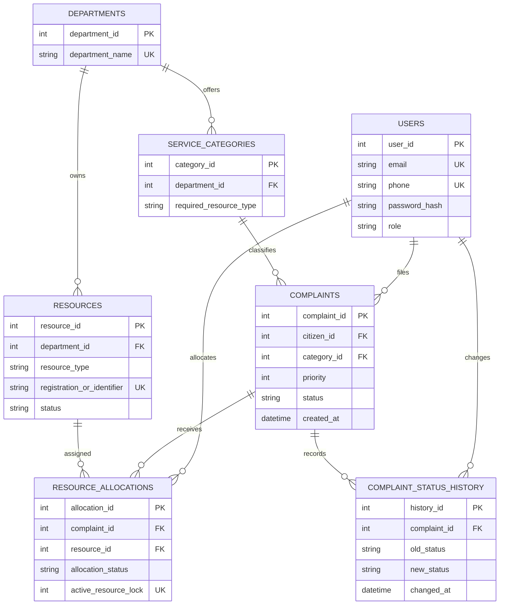
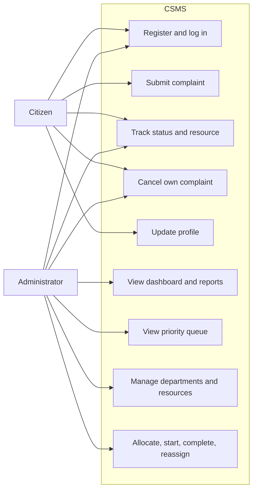
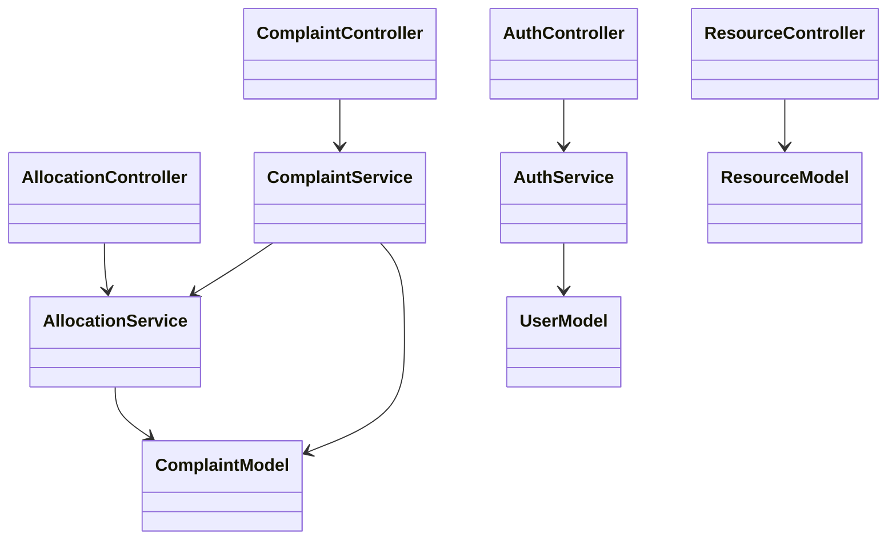
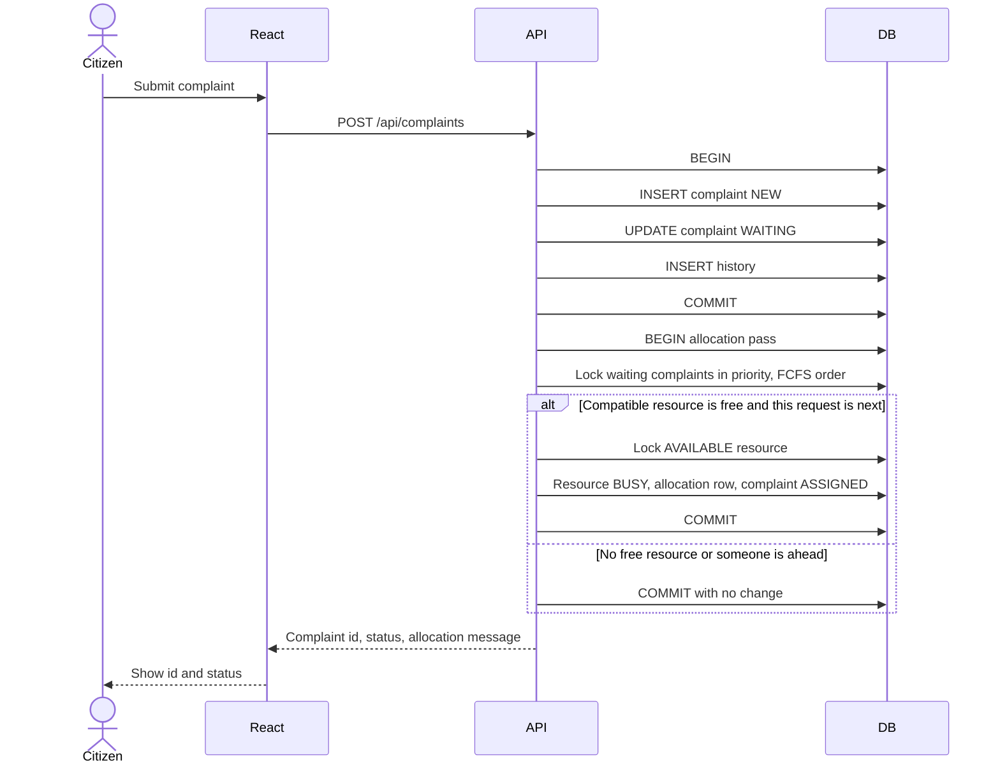
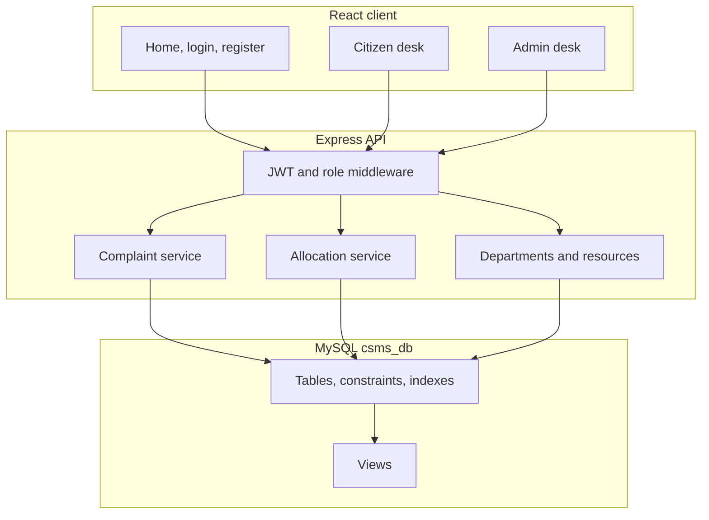
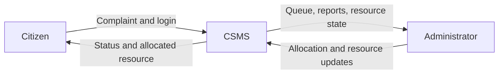
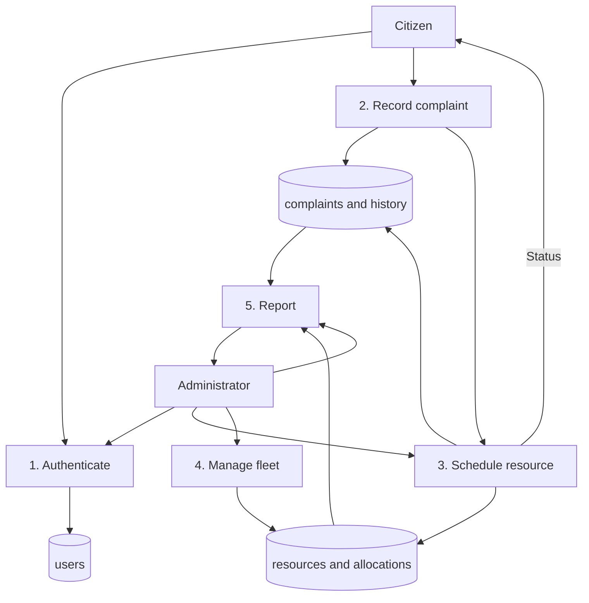

# Diagrams

These diagrams match the implemented tables, roles, and allocation transaction. Paste a block into any Mermaid preview (MySQL Workbench does not render Mermaid; VS Code and GitHub do).

## Entity-relationship diagram

## Use-case diagram

## Module diagram

The server is organised as modules rather than classes. This is the dependency a viva usually means by a class diagram.

`AllocationService` is the scheduler. It begins a transaction, locks rows, and commits or rolls back.

## Sequence: submit and allocate

## System architecture

## Data-flow diagram level 0

## Data-flow diagram level 1

